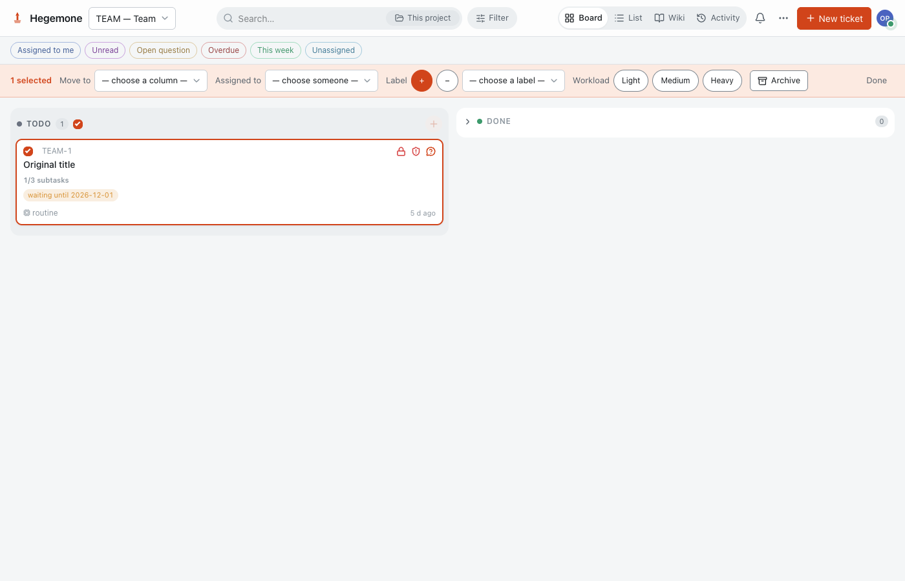
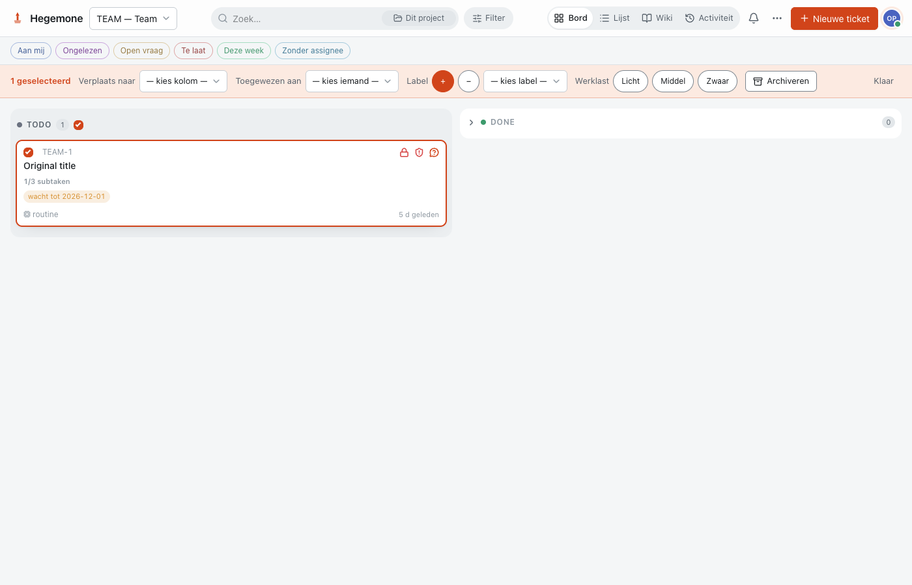

# Hegemone

Hegemone is a self-hosted Kanban and ticket system for people and AI agents.
It combines projects, task progress, a knowledge wiki, MCP access and optional
webhook integrations. Version 0.1.0 is the initial public release.

## Built with AI assistance, with checks you can inspect

Hegemone is developed with assistance from **Claude Code**
and **OpenAI Codex** for design, implementation, testing and documentation.

Security audits have been performed during development, and findings have led to
code changes and regression tests. Checks performed include authentication and
authorization tests, session and CSRF checks, webhook/SSRF validation, upload and
resource-limit tests, MCP/SSE revocation tests, dependency audits, secret scanning,
frontend tests, production builds and browser tests against isolated installations.
The test code is part of the source distribution, so these checks can be inspected
and repeated.

Verification is specific to a revision. A separate test agent has exercised a
fresh installation from the source archive, following this README with synthetic
data. Published releases are gated by the [verification workflow](https://github.com/sanderdatema/hegemone/actions/workflows/hegemone.yml),
including backend/frontend tests, dependency checks and container setup/MCP/restore/upgrade.
See [release verification](RELEASE_VERIFICATION.md) and [security](SECURITY.md)
for the observed scope and reporting guidance. Passing checks reduce risk; they do
not establish that the application is free of vulnerabilities.

## License

GNU General Public License v3.0 only (`GPL-3.0-only`). See the accompanying
`LICENSE` file for the full terms. The public repository destination is
[github.com/sanderdatema/hegemone](https://github.com/sanderdatema/hegemone).

## Source downloads

Use a Git checkout for development and publication checks. Release source archives
omit `.git`; download `SOURCE_MANIFEST.json` and `SHA256SUMS` from the same release
to verify the archive, its revision/tree identity and per-file hashes. Git archive
PAX metadata also records the source revision. Neither the application nor its
container installation requires Git metadata.

## Local container installation

Requirements: Docker Engine with the Compose plugin. No AI provider, Hermes
installation or external database is required. The browser setup flow supports
English and Dutch. English is the default, and Dutch can be selected in the app.

1. Copy `.env.example` to `.env`.
2. Generate two independent random values in your password manager, at least
   32 ASCII characters each. Set `HEGEMONE_MEDIA_SECRET` and
   `HEGEMONE_SETUP_TOKEN`. Never commit this file or send the values in URLs.
3. Run `docker compose build`, then `docker compose up -d`.
4. Open `http://localhost:8000`. Enter your setup token and create the first
   administrator. Save the displayed login key in your password manager.
5. Create the first project. Configure agents now or continue without them.
6. Remove `HEGEMONE_SETUP_TOKEN` from `.env`, then run `docker compose up -d`.

The port is bound to loopback by default. For remote access, place the service
behind your own HTTPS reverse proxy; forward the original host and scheme.
Set `HEGEMONE_PUBLIC_URL` to the URL users will open when you need a deployment override. This configuration does not
provision a public host, domain or network route.

The container runs as an unprivileged user, uses a read-only root filesystem and
stores the SQLite database and attachments in the `hegemone-data` named volume.
Do not use `docker compose down -v` unless you intend to delete all application
data. Run a single application worker; background work and rate limits assume
one process.

## Configuration and integrations

The browser wizard uses a dedicated setup token, not public registration.
An existing human user permanently closes first setup, including a disabled user.
Further users and agents are managed after sign-in through the application.
API keys are shown once; the browser uses an HttpOnly session and does not persist
your key in local storage.

AI triage and wiki compilation are off by default. Configure users, agent types,
model mappings and webhook delivery settings deliberately before enabling them.
No Hermes endpoint is assumed by the container configuration.
In **Agents & users**, human administrators can test an active agent's saved
webhook. This queues one synthetic stand-down event through the normal signed
delivery pipeline. The UI reports pending/retry/success/failure separately;
refreshing status does not send another test. Changing or disabling the target
before delivery cancels the test. Tickets and wiki content are never included.
Server-generated webhook instructions and Telegram text follow the saved
installation language, or the `HEGEMONE_LANGUAGE=en|nl` deployment override.
Browser notifications follow the browser language. Existing content and protocol
markers are kept. The AI output language is configured separately and defaults to `en`; use saved installation settings or the
`HEGEMONE_AI_LANGUAGE=en|nl` deployment override to choose it.
This installation setting is independent of the browser language and does not
translate existing tickets, wiki pages or chat history. To retain Dutch for both server messages and AI output when upgrading, choose
`nl` for both settings or set `HEGEMONE_LANGUAGE=nl` and
`HEGEMONE_AI_LANGUAGE=nl` as deployment overrides. Unsupported values prevent startup.
External webhook agents manage their own output language.
The browser translates recognized API error codes while retaining original error
details. Unrecognized provider messages remain in their original language. Server-generated
chat status and command-validation messages follow the installation language;
existing conversation content is preserved.
Open **More actions → Installation settings** as a human administrator to manage
installation defaults, AI providers and background-work opt-ins. The versioned API
is `/api/v1/settings/installation`. Deployment overrides are shown as managed
values. Save changes before testing a provider; the test sends only short synthetic
text and does not send tickets or wiki content.
Use **Import and export** in the same panel to download a version 1 configuration
file or review an import. Applying an import requires a separate confirmation.
Files omit credentials, delivery URLs and ticket/wiki content. Existing keys and
delivery endpoints are kept; newly imported agents start disabled. A preview
expires after ten minutes and must be regenerated if relevant settings change.

Saved provider keys are encrypted and are never returned. Back up the persistent
`HEGEMONE_SETTINGS_SECRET`, or the media secret used as its fallback, alongside
your database backup. Changing this secret requires re-encrypting saved keys.
Provider and worker changes take effect without a process restart. Optional
variables in `.env.example` are commented out so they do not mask saved settings.

Application runtime settings accept `HEGEMONE_*` names. Existing `BETONNING_*`
settings remain a compatibility fallback; an explicitly set new name takes
precedence. An empty new provider key disables that provider rather than silently
using an old key. Compose and `.env.example` use the public names throughout.
The Python import package, separate MCP CLI configuration and out-of-band Plane
migration tooling retain their historical names for compatibility; their broader
rename remains planned.

## Health and operation

`docker compose ps` shows the container health. `/health` confirms that the
application startup, including database migrations, has completed. The image
healthcheck calls this route. It is not an external integration availability test.

For a consistent backup, stop writes and archive the complete data volume:

```sh
docker compose stop hegemone
docker compose run --rm --no-deps -T --entrypoint tar hegemone -C /data -cf - . > hegemone-backup.tar
docker compose start hegemone
```

Store the archive and persistent runtime secret configuration in a private backup
location. Restore only to an empty data volume in a separate replacement
installation. The example uses a new Compose project, `hegemone-restore`, with
its `.env` and the same encryption material configured. On the same Docker host,
choose a free `HEGEMONE_PORT` and matching public URL before starting it:

```sh
docker compose -p hegemone-restore create hegemone
docker compose -p hegemone-restore run --rm --no-deps -T --entrypoint tar hegemone -C /data -xf - --no-same-owner < hegemone-backup.tar
docker compose -p hegemone-restore up -d
```

The helper runs as UID/GID 10001 and creates restored files under that identity;
this avoids relying on host filesystem ownership. Do not extract over an existing
running database or a directory with stale WAL files. Never upload a production
backup to public CI.

Focused tests cover schema-51 data preservation and stopped-directory restore.
The local Linux/arm64 container smoke also verified fresh setup, non-root volume
writes, authenticated MCP, encrypted-provider-key restore, attachments/wiki/comments
and a schema-51 upgrade using synthetic fixtures. These are point-in-time checks;
the verification workflow repeats these automated gates for the release revision.
The separate installation review is recorded in [RELEASE_VERIFICATION.md](RELEASE_VERIFICATION.md).

Before upgrades, back up and retain the previous image. Build the new source,
then run `docker compose up -d` and check health and sign-in. Database migrations
run on startup. A rollback across an incompatible migration requires restoring
the matching backup, not merely starting an old image.

## Development and current release gates

Backend: Python 3.12+, `uv sync --extra mcp`, then `uv run pytest`.
Frontend: `cd ui`, `npm ci`, `npm test`, `npm run build`.
Run targeted checks during development. Release candidates additionally require
the full verification workflow and an independent installation review. The public
repository contains a new source history; private development history is excluded.

## Project documentation

- [Agent setup](AGENT_SETUP.md): identities, permissions, MCP, REST and webhooks.
- [Contributing](CONTRIBUTING.md): development workflow, review and AI assistance.
- [Support and compatibility](SUPPORT.md): targets, verified scope and limitations.
- [Changelog](CHANGELOG.md): prepared changes and release status.
- [Security](SECURITY.md): verification scope and vulnerability reporting.
- [Release verification](RELEASE_VERIFICATION.md): observed installation checks and release gates.

Third-party licenses and copyright notices are preserved in [THIRD_PARTY.md](THIRD_PARTY.md) and [FRONTEND_LICENSES.txt](FRONTEND_LICENSES.txt).

## Screenshots

The board in English and Dutch, using synthetic tickets and a two-column example
project. New projects start with the six default columns described above.





For an existing systemd installation, see [native release deployment](NATIVE_DEPLOYMENT.md). Host profiles and secrets stay outside the repository.
